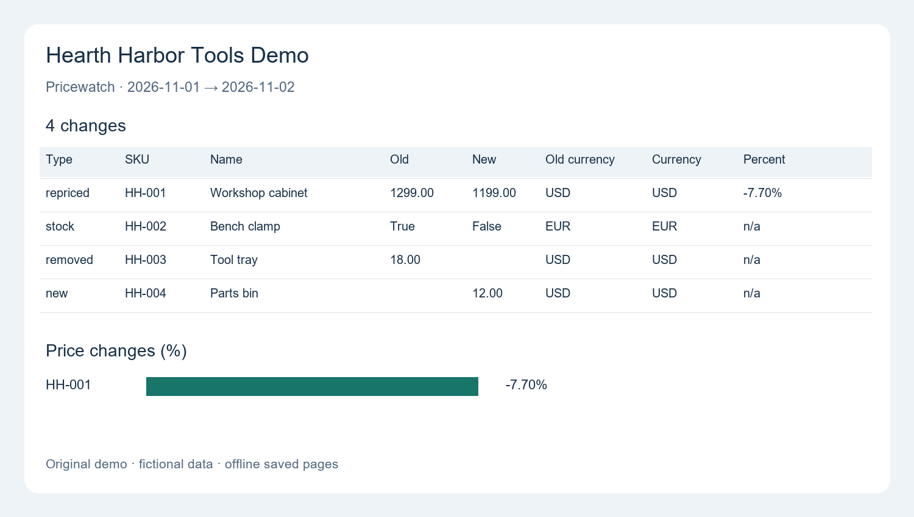

# demo-price-watch

Extract product prices from saved HTML catalogues and compare dated snapshots with an offline Python CLI.

## What it shows

- Two catalogue layouts (product grid and table), configured with CSS selectors.
- SKU-based detection of new, removed, repriced and stock-changed products.
- Price cleaning, deduplication, and explicit file/row errors for malformed data or unknown layouts.
- SQLite storage with one table per dated run.
- Text, CSV and JSON diffs, plus a static HTML report with an inline SVG price-change chart.



## Quick start

Requires Python 3.12 or newer. From the repository root, create and activate a virtual environment,
then install the package and development tools:

```console
python -m venv .venv
```

Activate with `.venv\Scripts\Activate.ps1` in Windows PowerShell, or
`source .venv/bin/activate` on macOS/Linux. Then run:

```console
python -m pip install -e ".[dev]"
python -m unittest discover -s tests
python -m ruff check .
python -m pricewatch extract fixtures/day1 --run 2026-11-01
python -m pricewatch extract fixtures/day2 --run 2026-11-02
python -m pricewatch diff 2026-11-01 2026-11-02
python -m pricewatch report 2026-11-01 2026-11-02 --html out/report.html
python docs/render_preview.py
```

Open `out/report.html` in a browser; the last command renders its real change rows and chart
into `docs/preview.png` using Pillow (a development dependency only).
The default database is `out/pricewatch.sqlite3`. To use another database, put
`--db path/to/snapshots.sqlite3` before the subcommand. Extracting an existing run date replaces that snapshot.

For machine-readable output:

```console
python -m pricewatch diff 2026-11-01 2026-11-02 --csv
python -m pricewatch diff 2026-11-01 2026-11-02 --json
```

## Example output

Pasted from a real run of the quick-start commands against the included fixtures:

```text
type | sku | name | old | new | currency | percent
repriced | HH-001 | Workshop cabinet | 1299.00 | 1199.00 | USD | -7.70
stock | HH-002 | Bench clamp | True | False | EUR | 
removed | HH-003 | Tool tray | 18.00 |  | USD | 
new | HH-004 | Parts bin |  | 12.00 | USD | 
```

The snapshots each contain three products. These four changes include a 7.70% price decrease,
a product going out of stock, a removal and an addition.

## Add a layout with selectors.json

Copy `pricewatch/selectors.json` to a JSON file of your own, retain the layouts you need,
and add a named entry. Each entry defines a `page` selector, a `rows` selector relative to that
page, and the six required fields. The first matching layout is used for each page.
For example:

```json
{
  "cards": {
    "page": ".catalogue-cards",
    "rows": ".item",
    "sku": {"selector": ":self", "attribute": "data-sku"},
    "name": {"selector": ".title"},
    "price": {"selector": ".price"},
    "currency": {"selector": ":self", "attribute": "data-currency"},
    "in_stock": {"selector": ":self", "attribute": "data-stock"},
    "url": {"selector": "a", "attribute": "href"}
  }
}
```

A field's `selector` selects within the row; `:self` means the row itself.
With `attribute`, the value comes from that HTML attribute; otherwise it comes from text.
Currency must be `USD`, `EUR` or `GBP`; stock must be `in` or `out`;
product URLs must be absolute HTTP(S) URLs. Prices such as `$1,299.00` and `1 299,00 EUR`
are normalized to Decimal values. `source_file` is recorded automatically.

Save representative HTML in a local folder and run:

```console
python -m pricewatch extract saved-pages --run 2026-11-03 --config my-selectors.json
```

Add fixture-based checks for the new layout in `tests/test_extract.py` before relying on it.

## Limits and failure reporting

- Reads saved UTF-8 `.html` pages recursively; it does not crawl live sites or execute JavaScript.
  When adapting it, respect each site's terms and robots.txt.
- Selectors must match the saved markup. Missing fields, malformed rows, empty layouts and unknown
  layouts produce explicit errors. If any page fails, extraction exits 1 and does not save the run.
  `fixtures/broken` contains malformed and unknown-layout examples, separate from the valid snapshots.
- Duplicate SKUs keep the first record encountered; a SKU should identify one product across snapshots.
- Comparisons use SKU, price, currency and stock. They do not track name or URL edits, convert currencies,
  or calculate percentage changes across currencies or from a zero old price.
- This is a small offline demo, without scheduling, browser automation or production monitoring.

## Provenance and AI-assisted credit

Original demo, fictional shop (Hearth Harbor Tools Demo) and fictional data; not client work.
No real shop names, brands or scraped data are used.

AI-assisted: Claude wrote the code, I directed and tested.
